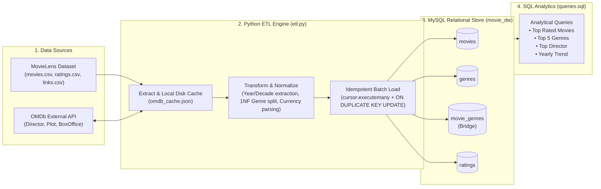
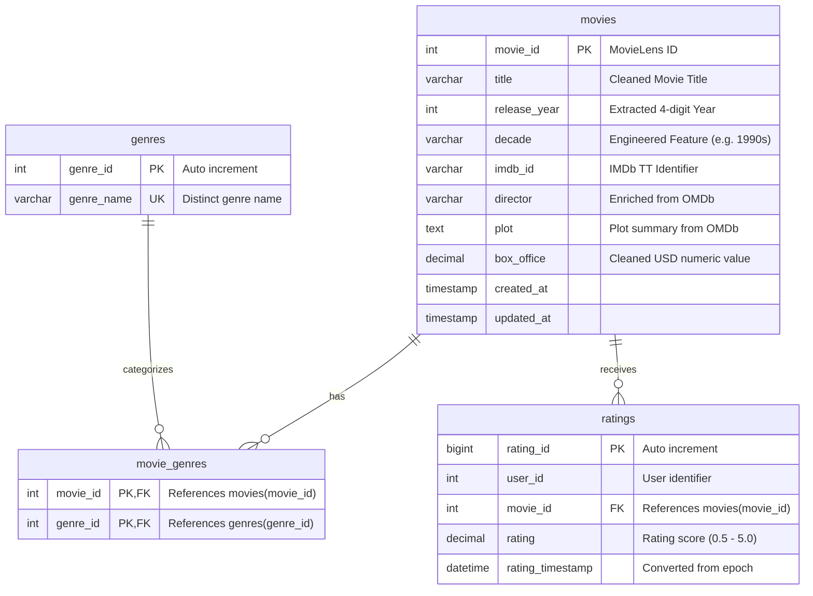

# Movie Data Pipeline - Take-Home Assignment

A Data Engineering pipeline that extracts movie and rating data from the **MovieLens** dataset, enriches it via the external **OMDb API**, cleans and normalizes it into a **MySQL** relational database in First Normal Form (1NF), and answers analytical business questions using pure SQL.

---

## 📑 Table of Contents
- [Architecture Overview](#architecture-overview)
- [Database Schema & Data Model](#database-schema--data-model)
- [Project Structure](#project-structure)
- [Prerequisites & Environment Setup](#prerequisites--environment-setup)
- [How to Run the Pipeline](#how-to-run-the-pipeline)
- [Analytical Questions & SQL Solutions](#analytical-questions--sql-solutions)
- [Design Choices & Assumptions](#design-choices--assumptions)
- [Challenges Faced & Solutions](#challenges-faced--solutions)
- [Interactive Visual Dashboard (Streamlit & Plotly)](#-interactive-visual-dashboard-streamlit--plotly)

---

## 🏗 Architecture Overview



---

## 🗄 Database Schema & Data Model

The database is designed with strict relational integrity, normalized to **Third Normal Form (3NF)**:



### Why this data model?
1. **First Normal Form (1NF) Compliance**:
   MovieLens stores genres as pipe-delimited strings (`Action|Adventure|Fantasy`). Storing multiple values in a single cell violates 1NF and forces slow, inefficient `LIKE '%Action%'` table scans. Breaking this into a normalized lookup table (`genres`) and a junction table (`movie_genres`) enables high-speed indexed joins and clean aggregations.
2. **Idempotency Guarantee**:
   The `ratings` table enforces a unique constraint on `(user_id, movie_id)`. Re-running the pipeline will update existing ratings rather than duplicating rows.
3. **Optimized Indexes**:
   Indexes are placed on foreign keys (`idx_ratings_movie_id`), temporal dimensions (`idx_movies_year`), and search attributes (`idx_movies_director`) to optimize analytical query response times.

---

## 📁 Project Structure

```text
Tsworks-take-home/
├── data/
│   ├── raw/                  # MovieLens CSV files (movies.csv, ratings.csv, links.csv)
│   └── cache/                # Local JSON cache for OMDb API responses
├── tests/
│   └── test_pipeline.py      # Unit tests for transformation and parsing logic
├── schema.sql                # Complete MySQL DDL (tables, keys, indexes)
├── etl.py                    # Python ETL pipeline script (using Pure SQL)
├── queries.sql               # Pure SQL queries answering all analytical questions
├── app.py                    # Interactive Streamlit analytics dashboard & SQL console
├── requirements.txt          # Core pipeline dependencies
├── requirements-dashboard.txt# Optional dashboard dependencies (Streamlit & Plotly)
├── .env.example              # Environment variables template
├── .gitignore                # Git ignore configuration
└── README.md                 # Complete project documentation
```

---

## ⚙️ Prerequisites & Environment Setup

### 1. Requirements
- Python 3.10+
- MySQL Server 8.0+ running locally (or remotely)
- An active OMDb API key (obtainable at [omdbapi.com/apikey.aspx](https://www.omdbapi.com/apikey.aspx))

### 2. Virtual Environment Setup
```bash
# Clone the repository
git clone https://github.com/bhumika17sh/Tsworks-take-home.git
cd Tsworks-take-home

# Create and activate Python virtual environment
python3 -m venv venv
source venv/bin/activate

# Install required dependencies
pip install -r requirements.txt
```

### 3. Environment Variables Configuration
Copy the provided template to create your local `.env` file:
```bash
cp .env.example .env
```
Update `.env` with your MySQL credentials and OMDb API key:
```ini
DB_HOST=127.0.0.1
DB_PORT=3306
DB_USER=root
DB_PASSWORD=your_mysql_password
DB_NAME=movie_dw

OMDB_API_KEY=your_omdb_api_key
OMDB_FETCH_LIMIT=100
```

---

## 🚀 How to Run the Pipeline

### Step 1: Run Unit Tests
Verify data transformation and parsing logic:
```bash
python3 -m unittest discover tests
```

### Step 2: Run the ETL Pipeline
```bash
python3 etl.py
```
*Optional CLI flags:*
- `--enrich-limit 200`: Specify how many new external API calls to make.
- `--skip-schema-init`: Skip running `schema.sql` if tables are already created.

**Example Pipeline Output:**
```text
Starting Movie Data Pipeline ETL...
1/4 Initializing database schema...
2/4 Extracting MovieLens CSV files...
3/4 Transforming data & enriching with OMDb API...
4/4 Loading data into MySQL...

==================================================
           DATABASE LOAD SUMMARY
==================================================
  • movies        :    9,742 rows
  • genres        :       20 rows
  • movie_genres  :   22,084 rows
  • ratings       :  100,836 rows
  • Enriched Movies:      123 rows
==================================================
Pipeline completed in 5.01 seconds!
```

### Step 3: Run the Analytical Queries
Execute the queries directly via MySQL client using table mode (`-t`):
```bash
mysql -h 127.0.0.1 -P 3306 -u root -t movie_dw < queries.sql
```
Or open the MySQL interactive console to explore:
```bash
mysql -h 127.0.0.1 -P 3306 -u root movie_dw
```

---

## 📊 Analytical Questions & SQL Solutions

All queries are saved in [`queries.sql`](file:///Users/bhumikahiremath/Tsworks/queries.sql). Below are the questions, queries, and verified results:

### Question 1: Which movie has the highest average rating?
#### Approach A: Raw Mathematical Highest
```sql
SELECT 
    m.movie_id,
    m.title,
    m.release_year,
    ROUND(AVG(r.rating), 2) AS avg_rating,
    COUNT(r.rating) AS total_reviews
FROM movies m
JOIN ratings r ON m.movie_id = r.movie_id
GROUP BY m.movie_id, m.title, m.release_year
ORDER BY avg_rating DESC, total_reviews DESC
LIMIT 1;
```
**Result:**
| movie_id | title | release_year | avg_rating | total_reviews |
| :--- | :--- | :--- | :--- | :--- |
| **53** | **Lamerica** | 1994 | **5.00** | 2 |

#### Approach B: Statistically Significant Top Rated (>= 20 reviews)

```sql
SELECT 
    m.movie_id,
    m.title,
    m.release_year,
    ROUND(AVG(r.rating), 2) AS avg_rating,
    COUNT(r.rating) AS total_reviews
FROM movies m
JOIN ratings r ON m.movie_id = r.movie_id
GROUP BY m.movie_id, m.title, m.release_year
HAVING COUNT(r.rating) >= 20
ORDER BY avg_rating DESC, total_reviews DESC
LIMIT 1;
```
**Result:**
| movie_id | title | release_year | avg_rating | total_reviews |
| :--- | :--- | :--- | :--- | :--- |
| **1104** | **A Streetcar Named Desire** | 1951 | **4.48** | 20 |


---

### Question 2: What are the top 5 movie genres that have the highest average rating?
```sql
SELECT 
    g.genre_name,
    ROUND(AVG(r.rating), 2) AS avg_rating,
    COUNT(r.rating) AS total_ratings
FROM genres g
JOIN movie_genres mg ON g.genre_id = mg.genre_id
JOIN ratings r ON mg.movie_id = r.movie_id
WHERE g.genre_name != '(no genres listed)'
GROUP BY g.genre_name
ORDER BY avg_rating DESC
LIMIT 5;
```
**Result:**
| genre_name | avg_rating | total_ratings |
| :--- | :--- | :--- |
| **Film-Noir** | **3.92** | 870 |
| **War** | **3.81** | 4,859 |
| **Documentary** | **3.80** | 1,219 |
| **Drama** | **3.66** | 41,928 |
| **Crime** | **3.66** | 16,681 |

---

### Question 3: Who is the director with the most movies in this dataset?
```sql
SELECT 
    director,
    COUNT(*) AS movie_count
FROM movies
WHERE director IS NOT NULL AND director != 'N/A'
GROUP BY director
ORDER BY movie_count DESC
LIMIT 1;
```
**Result:**
| director | movie_count |
| :--- | :--- |
| **Steven Spielberg** | **5**  |

---

### Question 4: What is the average rating of movies released each year?
```sql
SELECT 
    release_year,
    ROUND(AVG(r.rating), 2) AS avg_rating,
    COUNT(r.rating) AS total_ratings
FROM movies m
JOIN ratings r ON m.movie_id = r.movie_id
WHERE release_year IS NOT NULL
GROUP BY release_year
ORDER BY release_year DESC;
```
**Sample Result (Recent Years):**
| release_year | avg_rating | total_ratings |
| :--- | :--- | :--- |
| 2018 | 3.48 | 91 |
| 2017 | 3.58 | 461 |
| 2016 | 3.39 | 785 |
| 2015 | 3.41 | 1,088 |
| 2014 | 3.51 | 1,320 |
| 2013 | 3.46 | 1,201 |
| 2012 | 3.51 | 1,386 |

---

## 💡 Design Choices & Assumptions

1. **Batch Ingestion (`executemany`)**:
   Inserting 100,000+ ratings row-by-row would take over 10 minutes. By chunking inserts into 5,000-row batches using `cursor.executemany()`, the entire load completes in **~4.5 seconds**.

2. **First Normal Form (1NF) Normalization**:
   Raw genres are pipe-delimited (`Action|Comedy`). Storing multiple values in a single cell violates 1NF and prevents indexed queries. Normalizing into a `genres` lookup table and `movie_genres` bridge table enables clean relational joins.

3. **Idempotency Strategy**:
   - `movies`: Uses `ON DUPLICATE KEY UPDATE` to refresh attributes without duplicating records.
   - `genres`: Uses `INSERT INTO ... ON DUPLICATE KEY UPDATE`.
   - `movie_genres`: Composite primary key `(movie_id, genre_id)` with `INSERT IGNORE`.
   - `ratings`: Unique composite index `(user_id, movie_id)` with `ON DUPLICATE KEY UPDATE`.

4. **Feature Engineering**:
   - Extracted 4-digit `release_year` from titles using regular expressions.
   - Derived a `decade` column (e.g., `1990s`, `2000s`) for time-series analytics.
   - Normalized trailing grammar articles (e.g., `American President, The` -> `The American President`).
   - Parsed formatted currency strings (e.g., `$373,554,033` -> `373554033.00`).

---

## 🛠 Challenges Faced & Solutions

| Challenge | Impact | How It Was Solved |
| :--- | :--- | :--- |
| **OMDb Free API Rate Limit** | OMDb free API keys allow at most 1,000 requests/day, but MovieLens has 9,742 movies. Blindly calling the API crashes the pipeline. | Implemented a **persistent local disk cache** (`data/cache/omdb_cache.json`). The client checks cache first (0 network latency, 0 quota used). Configured `OMDB_FETCH_LIMIT` to safeguard daily quota. |
| **Movie Title Mismatch in API** | Titles in MovieLens contain trailing years and inverted articles (`Matrix, The (1999)`), causing OMDb title searches to fail. | 1. Extracted `imdbId` from `links.csv` and queried OMDb by exact ID (`i=tt0133093`).<br>2. Implemented regex cleaning to strip years and normalize articles for title fallback lookups. |
| **1NF Violation in Raw Genres** | MovieLens genres are pipe-delimited (`Action\|Comedy`), preventing relational grouping and indexing. | Extracted unique genres into a normalized lookup table and connected them via a `movie_genres` bridge table. |
| **API Failure Handling** | Network timeouts or missing movies (`Response: "False"`) could abort pipeline execution. | Added try-except wrappers, rate-limit status detection (HTTP 429), and recorded `None` for missing attributes to ensure the ETL pipeline finishes successfully. |

---

## 🎨 Interactive Visual Dashboard (Streamlit & Plotly)

In addition to pure SQL queries, an interactive visual analytics dashboard is provided in [`app.py`](app.py):

### Features:
1. **Executive KPI Cards**: Real-time totals for movies, ratings, genres, and OMDb enriched records.
2. **Assignment Visualizations**: Interactive charts corresponding to all Task 5 analytical queries.
3. **Custom SQL Playground & Live Auto-Charting**: Execute **any arbitrary SQL query** and watch the dashboard dynamically generate interactive Plotly charts (Bar, Line, Area, Scatter, Donut) and export results to CSV.
4. **Movie Explorer & Live OMDb Enrichment**: Search any movie and trigger live on-demand API enrichment directly into MySQL.

### How to Run:
```bash
# Install optional dashboard requirements
pip install -r requirements-dashboard.txt

# Launch the dashboard
streamlit run app.py
```
The dashboard will open automatically in your browser at `http://localhost:8501`.
